# castfig

A character kit for the Claude animation skills: body builds, outfits, hair, beards, glasses,
animals, pets and a Cupid for the **stick-figure** canvas rig, and the same vocabulary again for
the **three.js** rig. No dependencies beyond the pack itself.

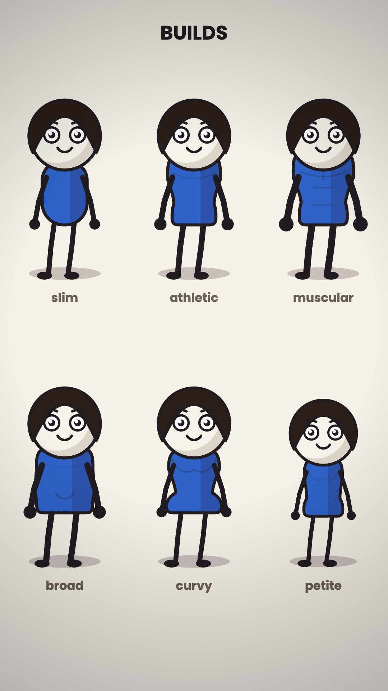

## This is an add-on, not an engine

Everything here sits on top of the Claude animation skills pack by **Artem Novitckii**, MIT
licensed:

> **https://github.com/artemnovitckii/claude-animation-skills**

That pack does the real work: the renderer, the compositor, the easing and drawing primitives, and
the original stick figure (`drawStick`, `drawFace`, the two-bone arm IK). `castfig` adds one file,
`cast.js`, which reuses that rig and gives it more than one kind of body. **It does not modify the
pack**, and that is deliberate: keep the pack a clean upstream clone so `git pull` keeps working,
and keep your own additions in a file beside it.

If you want the thing that renders videos, go to the pack. If you are already using it and your
characters all look like the same person, you want this.

## Install

```bash
# the engine
git clone https://github.com/artemnovitckii/claude-animation-skills ~/claude-animation-skills
bash ~/claude-animation-skills/install.sh

# this kit, into a reel
cp cast.js <your-reel>/web/cast.js
```

Then add it to `<your-reel>/web/index.html`, **after `chars.js`**:

```html
<script src="chars.js"></script><script src="cast.js"></script>
```

## Use

`castFig(ctx, o)` takes every option `drawStick(o)` takes, and adds these:

| option | values |
|---|---|
| `build` | `slim` `athletic` `muscular` `broad` `curvy` `petite` |
| `outfit` | `tee` `tank` `shirt` `classic` `knit` `hipster` · `sport` `hoodie` · `leather` `coat` · `business` `smart` `tux` `toga` · `dress` `gown` · `trunks` `boardies` `onePiece` `bikini` |
| `hair` | `buzz` `crop` `fringe` `quiff` `pixie` `curls` `afro` `bob` `waves` `long` `longWavy` `ponytail` `highPony` `bun` `manBun` `braid` |
| `hairCol` | `black` `darkBrown` `brown` `chestnut` `auburn` `ginger` `sand` `blonde` `lightBlonde` `platinum` `ash` `grey` `silver` `white` `red` `brightRed` `plum` `pink` `brightPink` `blue` `teal` `violet`, or any CSS colour |
| `skin` | `porcelain` `fair` `light` `tan` `olive` `brown` `deep` `dark`, or any CSS colour |
| `beard` | `stubble` `short` `full` `goatee` `moustache` (+ `beardCol`) |
| `glasses` | `round` `square` `rect` (+ `glassesCol`) |
| `animal` | `bear` `panda` `lion` `whiteLion` `tiger` `whiteTiger` `dog` `cat` (+ `furCol` `muzCol` `maneCol`) |
| `wings` `halo` | `true`, for a Cupid, an angel or a fairy (+ `wingCol` `haloCol`) |
| `necklace` | `pearls` `chain` `pendant` (+ `necklaceCol`) |
| `earrings` | `hoop` `stud` `drop` (+ `earringCol`) |
| `fur` `watch` `heels` | `true` (+ `furStoleCol` `watchCol` `heelCol`) |
| `nails` | a colour, on both hands |

```js
// a person
castFig(ctx, { x: 540, y: 1560, s: 900, build: 'broad', hair: 'buzz', hairCol: 'darkBrown',
               beard: 'short', glasses: 'square', skin: 'tan',
               outfit: 'shirt', cols: ['#2f63c9', '#eef1f5'] });

// an animal, wearing the same clothes, using the same poses
castFig(ctx, { x: 540, y: 1560, s: 900, animal: 'panda', outfit: 'hoodie',
               cols: ['#d8604e', '#d8604e'] });

// presets are plain options objects, so override anything
castFig(ctx, Object.assign({}, RICH_MAN,   { x, y, s, t }));
castFig(ctx, Object.assign({}, GLAM_WOMAN, { x, y, s, t }));

// a Cupid: CUPID is a plain options object, so override anything
castFig(ctx, Object.assign({}, CUPID, { x: 540, y: 1560, s: 640, t, skin: 'brown', hair: 'afro' }));

// a dog on four legs, beside someone
petFig(ctx, { x: 790, y: 1560, s: 420, kind: 'dog', t });
```

`BUILD_LIST`, `OUTFIT_LIST`, `HAIR_LIST`, `HAIRCOL`, `SKIN_LIST` and `ANIMAL_LIST` are exported so
you can iterate the whole set, which is how the sheets below are drawn.

The presets (`CUPID`, `RICH_MAN`, `GLAM_WOMAN`) are bundles of the options above and nothing more.
The parts are named for what they are, a stole and pearls and dark glasses, rather than for a
character type, because the same parts are a film star, a mourner or a villain depending only on
what the script has them doing.

### The two colours

`cols[0]` is the garment and `cols[1]` the second colour, read differently per outfit: the stripes
on a `tee`, the collar tipping on `classic`, the shoulder yoke on `sport`, the tie on `business`,
the belt on `dress`, the side stripe on `boardies`. When `cols[1] === cols[0]` each outfit shades
the first colour itself, so a one-colour call still looks right. `tux` ignores both and is always
black and white; `leather` darkens whatever you give it by 30% so it reads as leather in any colour.

## What it looks like

| | |
|---|---|
| 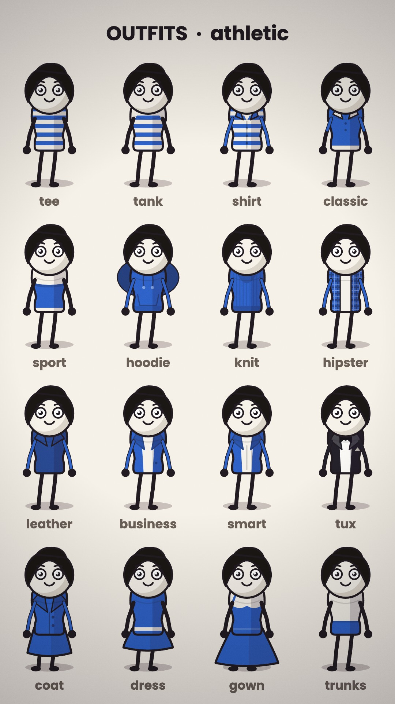 | 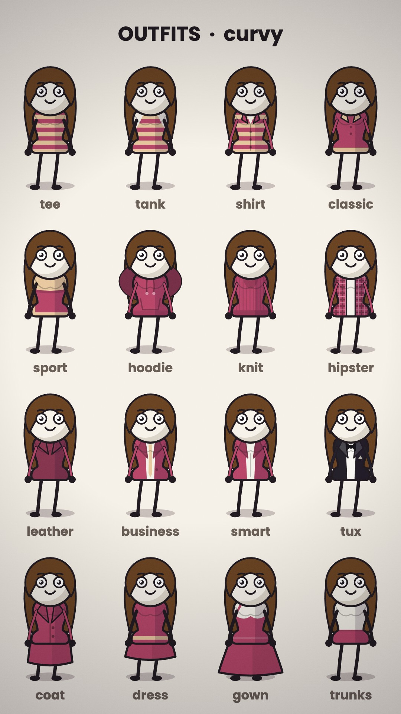 |
| 19 outfits, athletic | the same 19, curvy |
| 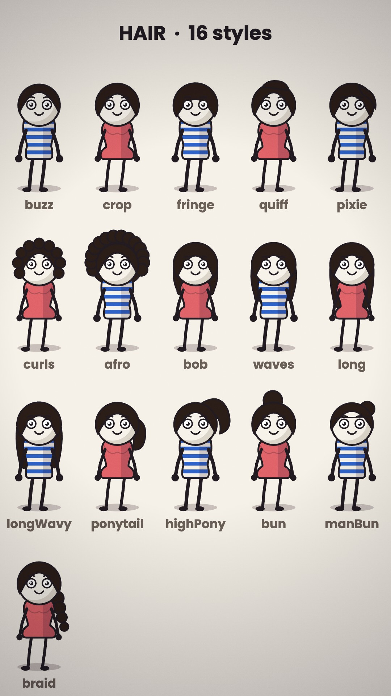 | 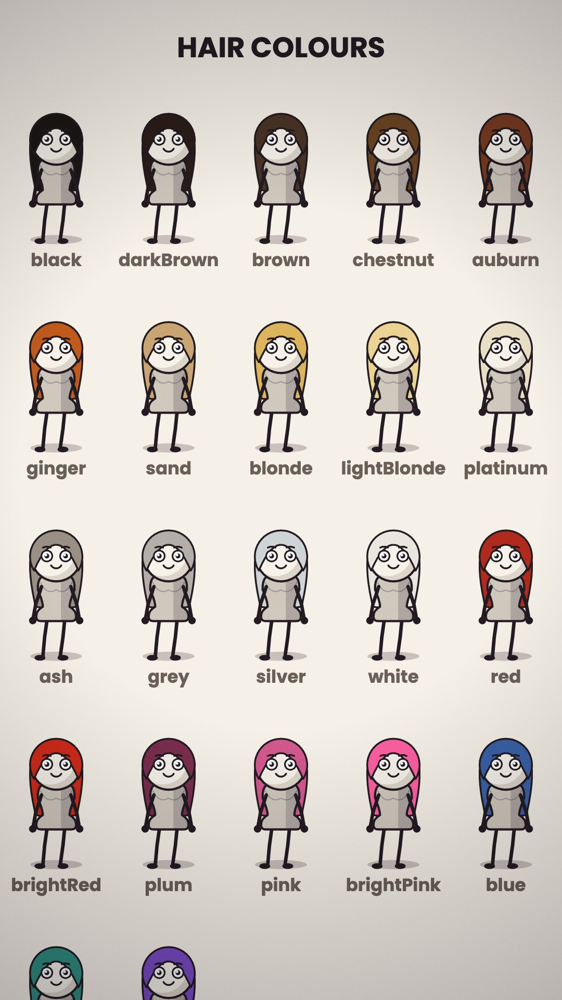 |
| 16 hairstyles | 22 hair colours |
| 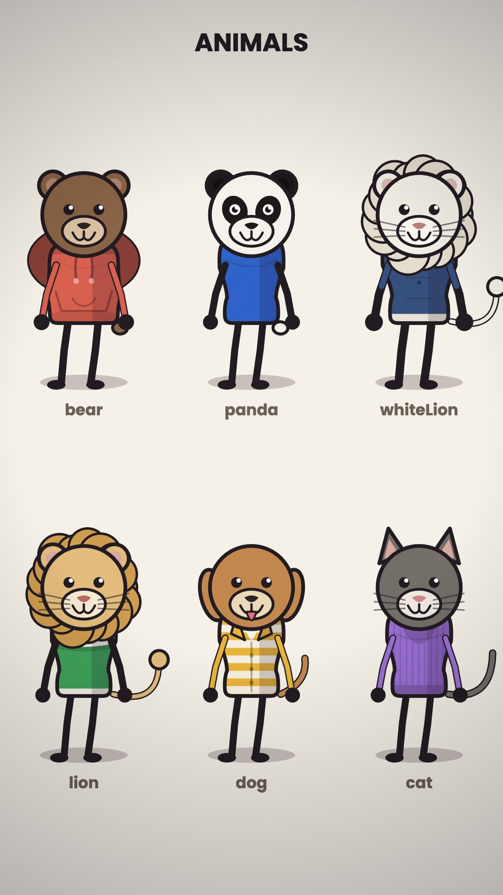 | 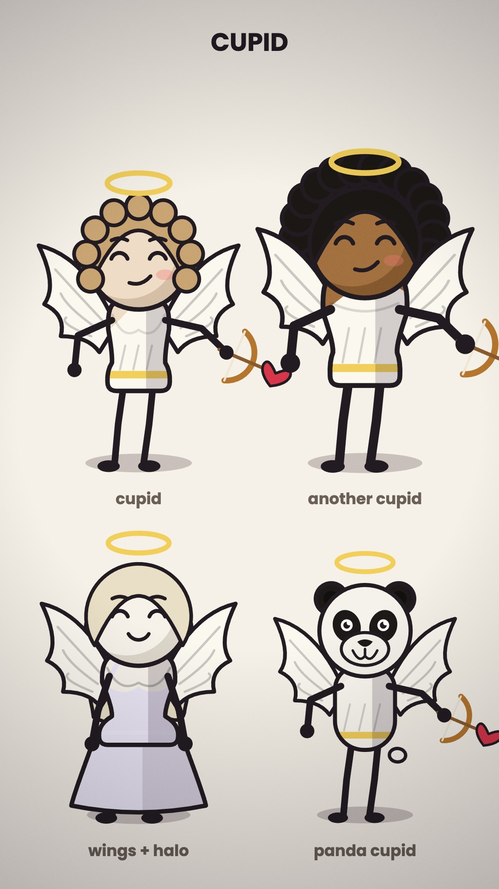 |
| animals in clothes | Cupid, wings and halo |
| 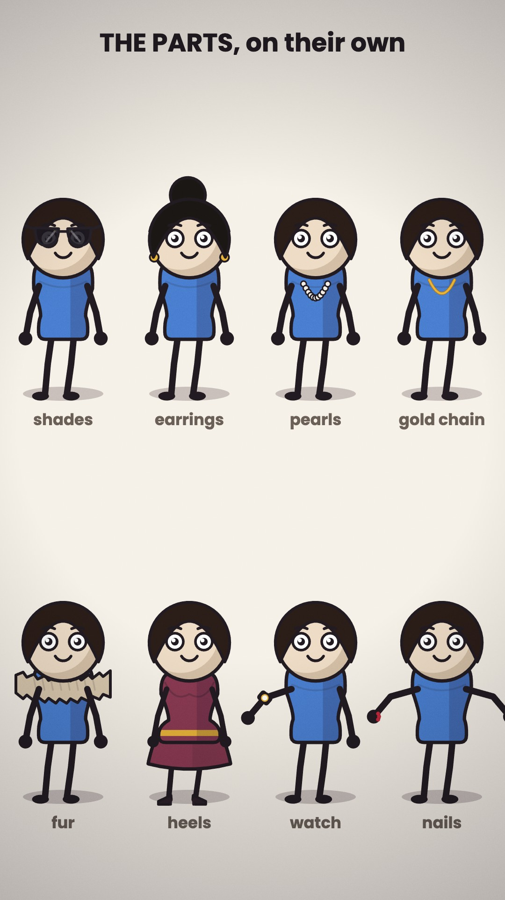 | 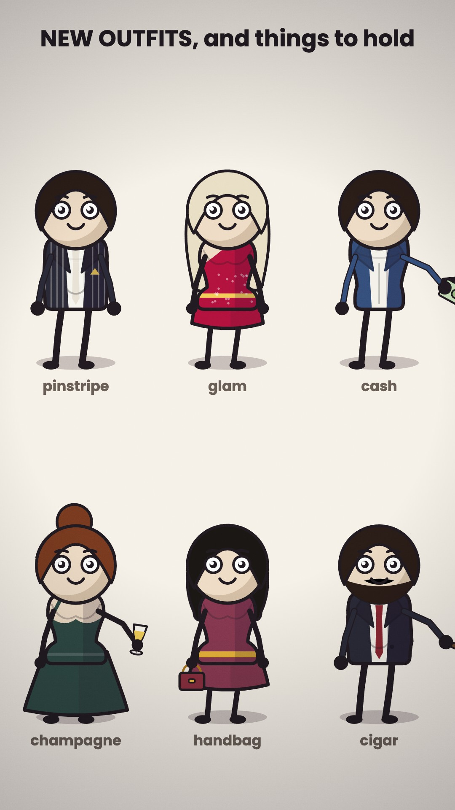 |
| shades, jewellery, fur, heels, nails | pinstripe, glam, and things to hold |

Also in `sheet/`: skin tones, four-legged pets, and the drop-in proof below. `examples/` holds the
`shots.js` files that drew every page, so you can re-render them after a change:

```bash
export NODE_PATH=~/claude-animation-skills/kit/node_modules
node ~/claude-animation-skills/skills/stick-figure/engine/tools/render.js stills 0.5,1.5,2.5
```

## It is a drop-in

`build: 'slim'` with `hat: 'none'` draws exactly what `drawStick` draws, pixel for pixel. The proof
is `sheet/8-drawstick-vs-castfig-slim.jpg`: the two figures overlaid in one frame, one of them
50% cyan, with no red showing anywhere. So you can convert a scene one figure at a time.

Two differences to know about: `castFig` defaults `hat` to `'none'` where `drawStick` defaults to a
bandana, and it never draws the pirate belt.

## Notes if you extend it

Things learned building this, in case they save you a render.

**Work in the rig's unit space.** Everything is multiplied by `s`, with the feet at 0:

| | |
|---|---|
| feet | `0` |
| hip joint | `-0.30` |
| torso bottom | `-0.27` (below the hip, so it covers the leg tops) |
| shoulder | `-0.535` |
| torso top | `-0.60` to `-0.645`, per build |
| head centre | `-0.765` (`HY`) |
| head radius | `0.19` (`HR`) |
| eyes | `±0.072` across, `HY - 0.005`, radius `0.042` |

Write new parts against `HY` and `HR`, never against literals, or they break on the next build.

**Draw order is fixed and it matters.** The rig lays down: back hair, tail, wings and hood, then
legs, then skirt, then torso, then arms, then head, then front hair, then face, then glasses and
halo. Anything that belongs behind the body has to be issued in that early pass, in body space.
Back hair drawn with the head paints over the torso. A hood that rotates with the head looks wrong,
because a hood follows the shoulders.

**Prefer an option to a new function.** An animal here is just a different head, which is why a bear
can wear a hoodie and hold a phone with no new code. Write a separate function only when the thing
genuinely is not a biped: `petFig` exists because a dog standing on two legs beside a person is a
gag, not a pet.

**Render a sheet before you trust it.** None of these were visible in code review: every animal
smiling with the mouth curve inverted into a frown, a hairline sitting below the eyes, a lion's mane
that read as a sunflower, wings wide enough to overlap the next figure, and a four-legged dog with a
head the size of its body. `examples/` exists so you can look.

## And the same thing in 3D

`cast3d.js` does for the pack's **three.js** rig what `cast.js` does for the stick figure. That rig
lives in the `zach-d-films` skill and renders procedural people, but it was built for an armour
short, so its only outfits are `plate`, `knight`, `archer` and `vest`.

```js
import { makeFigure3D, STAND3 } from './cast3d.js';
const f = makeFigure3D({ build: 'curvy', skin: 'tan', hair: 'bun', hairCol: 'auburn',
                         glasses: 'round', outfit: 'dress', cols: ['#c2566f', '#e8b43a'] });
f.setPose(STAND3);
scene.add(f.root);
```

Six builds, six outfits (`tee` `shirt` `hoodie` `knit` `suit` `dress`), six hairstyles, four beards,
three glasses, eight skin tones, twenty hair colours. **The option names are the same as the 2D
kit's**, so one character description drives either renderer. `setPose` takes the same joint map
`makeHuman` does.

It has the rest of the 2D kit's vocabulary too: the same eight animals as a different **head** on
the same body (`animal: 'panda'`), so a bear can wear a hoodie here as well; `wings`, `halo`,
`necklace`, `earrings`, `fur` and `watch`; `makePet3D({ kind })` for the four-legged ones; and the
presets `CUPID3`, `RICH_MAN3`, `GLAM_WOMAN3` and `GOLD_DIGGER3`.

```js
import { makeFigure3D, makePet3D, CUPID3, STAND3 } from './cast3d.js';
const bear = makeFigure3D({ animal: 'bear', outfit: 'hoodie', cols: ['#d8604e', '#f3e3c2'] });
const cupid = makeFigure3D(CUPID3);
const dog = makePet3D({ kind: 'dog' });
```

It imports exactly one thing from the pack, `torsoShell`, and builds the rest itself, so nothing in
`human.js` is modified.

| | |
|---|---|
| 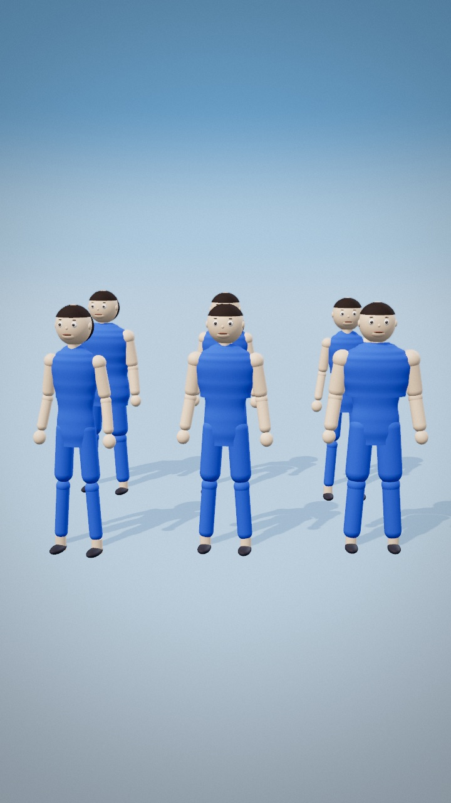 | 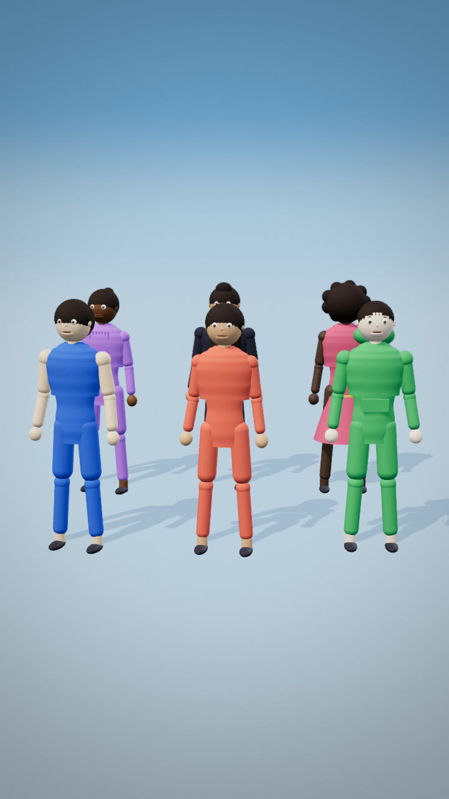 |
| six builds | six outfits, six skin tones |
| 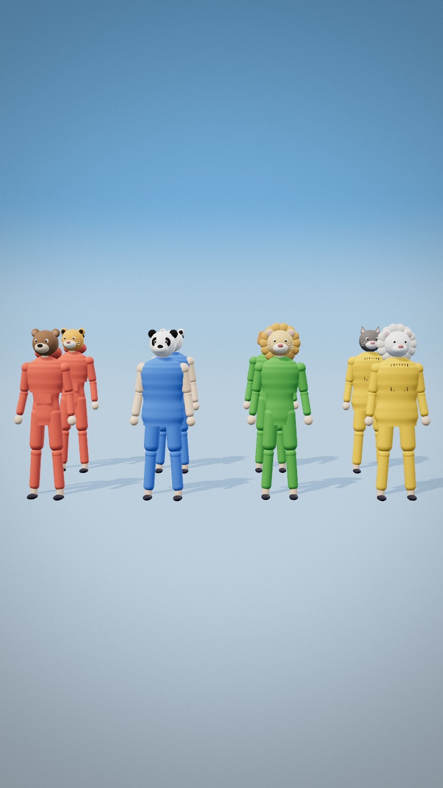 | 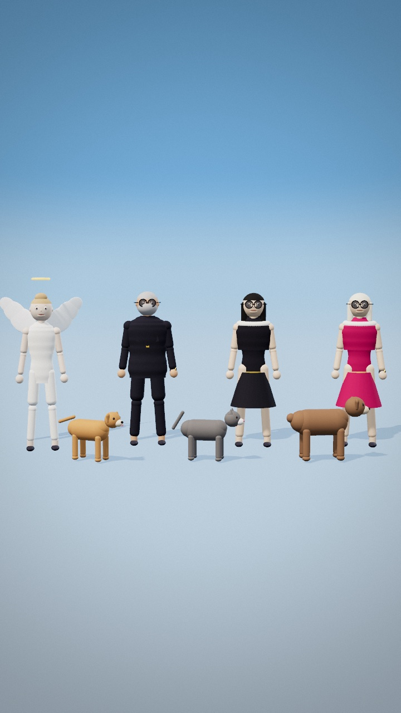 |
| eight animals, dressed | Cupid, the presets, and the pets |

Four things that cost me a render. **ESM ignores `NODE_PATH`**, so symlink the kit's `node_modules`
into the project rather than setting it. **`makeStage` returns the scene directly**, not `{ scene }`.
**Fit the camera, do not guess it**: half-width is `tan(fov/2) * distance * aspect`, and three
figures 1.9 units apart need a distance of twelve, not eight. And **a wing sweeps out, not up**:
stacking the pieces along y gives you a white hoop behind the head.

## Who made this

Built at **[CMeIn](https://cmein.com)**, where it animates the explainer reels for an AI
dating-photo product. None of that is in here: this is the character kit on its own, because the
kit is useful whether or not you care what it was built for.

The reels this kit draws go out here:

[Instagram](https://www.instagram.com/cmein.app/) ·
[YouTube](https://www.youtube.com/@cmein-ai) ·
[Threads](https://www.threads.com/@cmein.app) ·
[Facebook](https://www.facebook.com/profile.php?id=61590427634614)

If it saves you some work, the nicest thing you can do is star
[the pack it runs on](https://github.com/artemnovitckii/claude-animation-skills).

## Licence

MIT, see `LICENSE`. The animation pack it builds on is MIT too and belongs to Artem Novitckii;
please keep the credit if you fork this.

The reference sheets were rendered with Poppins and Lora, both under the SIL Open Font License,
which ship with the pack rather than with this repo.
